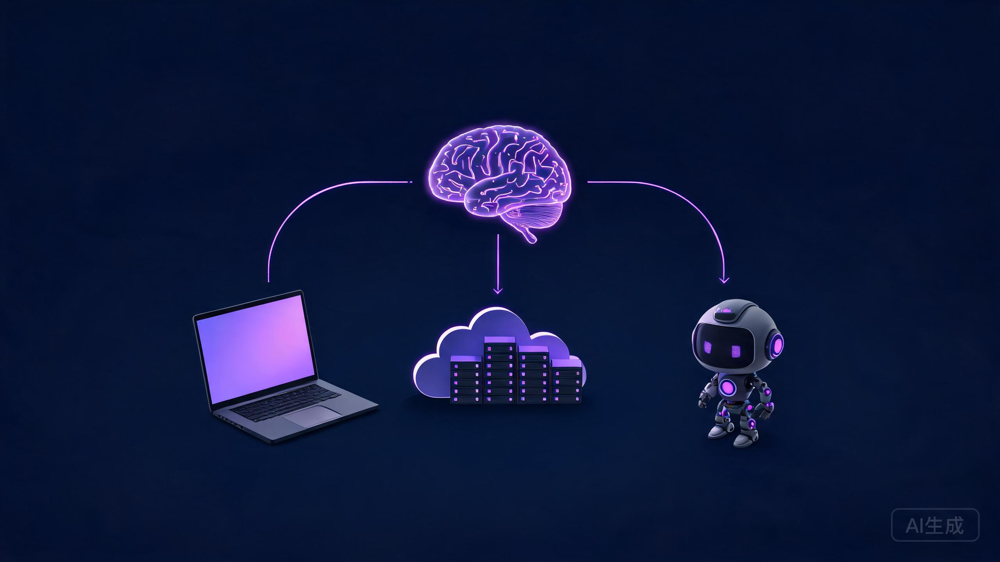
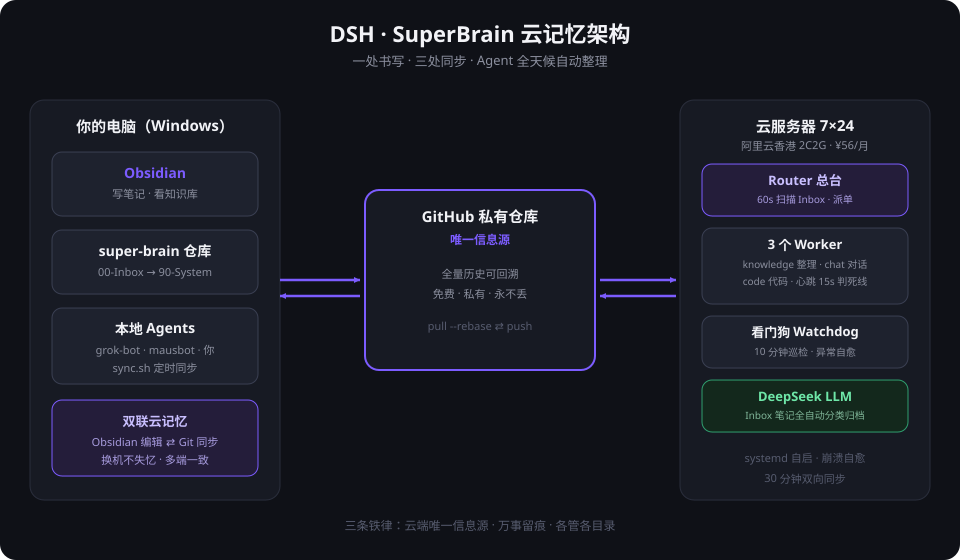
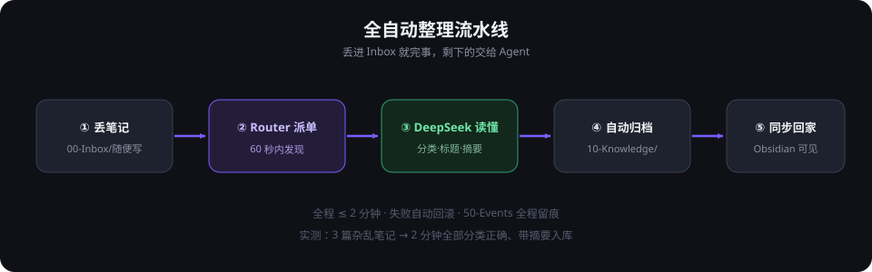

<div align="center">



# DSH · SuperBrain

### 让你的 AI 拥有「永不失忆的云大脑」

**一条命令，把你的 Obsidian 升级成 7×24 在线、多 Agent 协同、全自动整理的超级记忆系统**

[](LICENSE)
[](#)
[](#-成本)
[](AGENTS.md)
[](#dsh-插件)
[](https://dsh-plugin.org/plugins/dagu8888/dsh-plugin-superbrain)

</div>

---

## 你是不是也这样？

- 跟 AI 聊了一下午的神仙方案，**关掉窗口就没了**
- 灵感记在便签、微信、备忘录、Obsidian……**找的时候全找不到**
- 同时养着好几个 AI 助手，它们**互相不知道对方干了啥**
- 换台电脑，等于**给大脑做了一次格式化**

**SuperBrain 一套解决：一个 GitHub 仓库做「唯一信息源」，一台 2C2G 云服务器做「永动机」，你的每一个 AI 都读写同一个大脑。**

## 架构



**三层结构，各就各位：**

| 层 | 角色 | 干什么 |
|---|---|---|
| 🧠 大脑 | GitHub 私有仓库 | 唯一信息源，全量历史可回溯，免费 |
| ⚡ 神经 | 云服务器（2C2G） | Router 派单 + 3 Worker 干活 + 看门狗巡检 |
| ✍️ 双手 | Obsidian + 本地 Agent | 你只管写，整理归档全自动 |

## 全自动整理流水线



往 `00-Inbox` 丢一篇随便写的笔记 → **2 分钟内**，DeepSeek 自动完成分类、起标题、写摘要、归档进知识库、同步回你电脑。失败自动回滚，全程留痕，绝不丢笔记。

## 为什么敢叫 SuperBrain

- **🪶 轻到离谱**：运行时 ~150 行纯标准库 Python，零依赖，2C2G 服务器流畅跑
- **🐕 自带看门狗**：每 10 分钟巡检，git 冲突/同步停滞/Inbox 积压，能自愈的自愈，不能的报警
- **💓 有心跳**：Worker 15 分钟无心跳自动判死，systemd 崩溃自动重启
- **📜 三条铁律**：云端唯一信息源 · 万事留痕 · 各管各目录 —— 多 Agent 不打架
- **🔓 全开放**：所有配置就是几个 YAML 和 Markdown，看得懂就改得动
- **💰 穷鬼友好**：服务器 ¥56/月 + LLM 几分钱/百篇，**一个月不到 60 块**

## 成本

| 项目 | 费用 |
|---|---|
| 云服务器（阿里云香港 2C2G，也可换任何厂商） | ≈ ¥50/月 |
| DeepSeek API（自动整理） | ≈ ¥1/月 |
| GitHub 私有仓库 | ¥0 |
| **合计** | **< ¥60/月** |

## 快速开始 —— 让你的 Agent 来装

这是 SuperBrain 最骚的用法：**你一行命令都不用敲**。

### DSH 插件

如果你在用 [DeepSeek Harness](https://www.deepseek.com/harness/)，一条命令装进你的 DSH：

```bash
dsh plugin --profile web add github:dagu8888/DSH-SuperBrain
```

装上后获得两个新工具：

| 工具 | 干什么 |
|---|---|
| `superbrain_remember` | 把当前对话里值得长期记住的内容写进云大脑（00-Inbox），云端 Agent 2 分钟内自动分类归档 |
| `superbrain_sync` | 立即触发知识库 ⇄ 云端双向同步 |

> 兼容性：声明 `dshTarget: rc.6`（DSH 处于开发者预览期，如遇破坏性变更请提 issue）。插件本体见 [index.js](index.js)，纯 Node 标准库，零依赖。

### 手动 / 其他 Agent

```bash
git clone https://github.com/dagu8888/DSH-SuperBrain.git
```

然后把这句话丢给你的 AI（Claude / GPT / Trae / 任何 Agent）：

> **「读 DSH-SuperBrain/AGENTS.md，带我搭建。」**

你的 Agent 会照着安装协议，一步一步问你该问的（买哪家服务器、用哪家 LLM），替你敲完所有命令，最后交付一套跑起来的系统。

想自己动手？看 👉 [docs/教程.md](docs/教程.md)（保姆级，非技术背景实测通关）

## 仓库结构

```
DSH-SuperBrain/
├── AGENTS.md          🤖 Agent 自动安装协议（核心！给 AI 看的）
├── README.md          你正在看的这个
├── docs/教程.md        📖 保姆级图文教程（给人看的）
├── kit/               🧰 全套可运行模板
│   ├── 40-Agents/     Router / Worker / 看门狗配置 + 三条铁律
│   └── 90-System/     sync.sh · watchdog.sh · runtime.py · systemd 单元
└── assets/            架构图 · 流水线图
```

## 三条铁律（所有接入的 Agent 必须签字）

1. **云端仓库是唯一信息源** —— 干活先 pull，干完必 push
2. **万事留痕** —— 一切动作追加写入 `50-Events/`，只增不改
3. **各管各的目录** —— 越界即违规

## License

MIT —— 随便用，改出花来记得回来说说。

---

<div align="center">
<sub>Built by 大古老师 & his agents ｜ 2026-11-08 一天之内从零到上线</sub>
</div>
